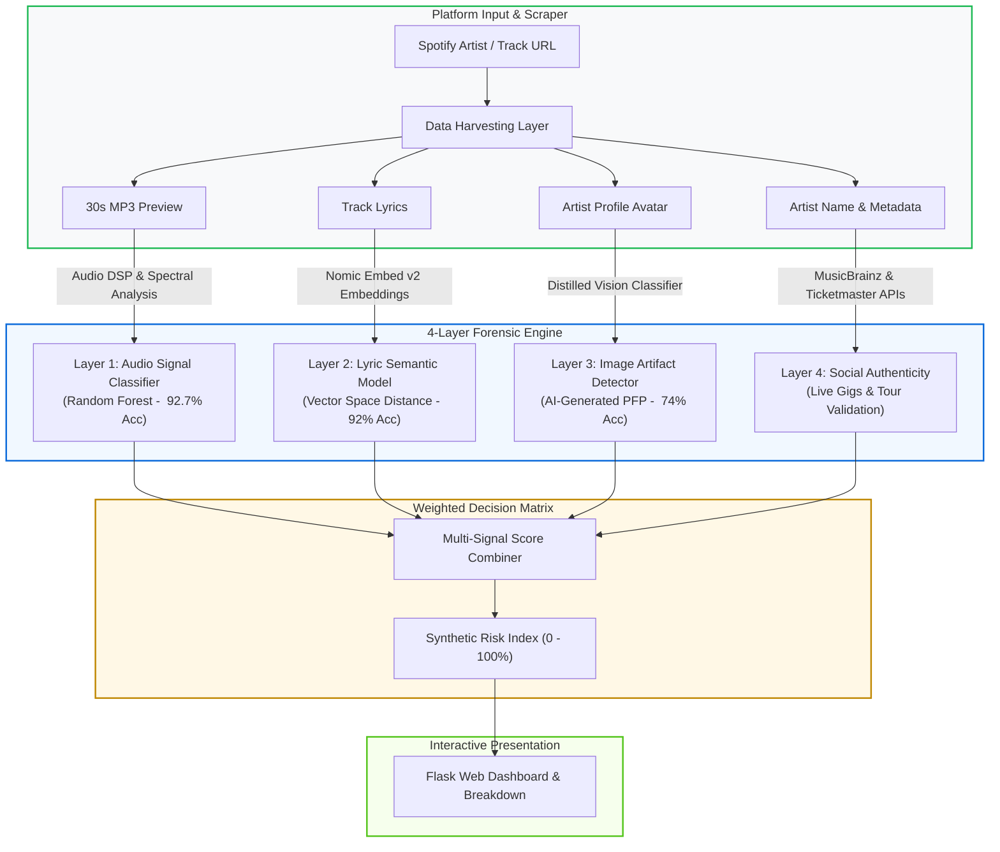

<div align="center">

# 🎧 Derek: Multimodal AI Music & Synthetic Artist Detector
### A 4-Layer Forensic Framework for Detecting Generative Music on Streaming Platforms

[](https://www.python.org/)
[](https://scikit-learn.org/)
[](https://huggingface.co/)
[](https://flask.palletsprojects.com/)
[-gold.svg)](#-acknowledgements)

*Awarded Best Overall Presentation at the University of Amsterdam Data Sprint. Derek interrogates streaming catalog integrity through acoustic DSP, semantic lyrics embeddings, visual artifact analysis, and live ecosystem validation.*

[System Architecture](#-system-architecture) • [Multi-Layer Detection Engine](#-multi-layer-detection-engine) • [Benchmark Performance](#-benchmark-performance) • [Quickstart](#-quickstart) • [Limitations](#-limitations--future-roadmap)

---

</div>

## 📌 Problem & Research Scope

Generative audio engines (Suno, Udio) have made deploying synthetic tracks to streaming platforms friction-free. Identifying synthetic music purely through audio is fragile: human creators frequently use AI-assisted artwork, while authentic indie musicians may have sparse online footprints.

**Research Question:** *To what extent can digital data methods and multimodal feature fusion reliably identify synthetic artists and generated tracks on Spotify?*

**Derek** is an end-to-end forensic pipeline that moves beyond single-point classifiers. Acting as a weighted multi-signal auditor, Derek evaluates tracks and artists across four distinct dimensions:
1. **Audio Acoustic Fingerprinting**
2. **Lyric Semantic Clustering**
3. **Artist Profile Picture (PFP) Forensics**
4. **Social & Live Ecosystem Authenticity**

---

## 🏗️ System Architecture



---

## 🔬 Multi-Layer Detection Engine

### 1. Audio Signal Fingerprinting (92.7% Accuracy)
Extracts low-level acoustic and psychoacoustic features using signal processing algorithms:
- **Feature Extraction:** Mel-Frequency Cepstral Coefficients (MFCCs), Fast Fourier Transforms (FFT), Spectral Centroid/Rolloff, Novelty Functions, and automated Chord & Key regularity estimators.
- **Model:** Tuned Random Forest Classifier trained on paired human and generative audio sets, detecting phase inconsistencies and frequency compression typical of synthetic decoders.

### 2. Lyrics Semantic Clustering (92% Accuracy)
Synthetic lyrics frequently exhibit repetitive thematic loops and distinct lexical predictability:
- **Embeddings:** Vectorized via `nomic-ai/nomic-embed-text-v2` through the LyricLib API.
- **Classification:** Evaluates semantic proximity against known corpora of generated prompt lyrics vs. human songwriting datasets.

### 3. Profile Image Forensics (74% Accuracy)
Evaluates visual artifacts in artist marketing assets:
- **Model:** HuggingFace `AI Image Detector - Distilled` evaluating Spotify high-resolution artist avatars for diffusion artifacts, unnatural lighting coherence, and hyper-smoothing.

### 4. Ecosystem & Live Presence Verification
Mitigates false positives for human independent artists:
- **Cross-Referencing:** Live lookups across the **MusicBrainz Open Database** and the **Ticketmaster Discovery API**.
- **Logic:** Verified live tour dates, physical ticketing footprints, or registered publishing credits heavily down-weight synthetic suspicion.

---

## 📊 Benchmark Performance

| Dimension | Underlying Technology / Source | Primary Features | Accuracy |
| :--- | :--- | :--- | :---: |
| **Audio Classifier** | Scikit-Learn (Random Forest) | MFCC, Spectral Rolloff, Chords, Novelty | **92.7%** |
| **Lyrics Analysis** | `nomic-embed-text-v2` | Dense semantic embeddings, vocabulary entropy | **92.0%** |
| **Visual Avatar** | Distilled Vision ViT | Surface diffusion artifact analysis | **74.0%** |
| **Social Graph** | Ticketmaster & MusicBrainz APIs | Live tour events, historical releases, discography | *Heuristic Anchor* |

---

## 🚀 Quickstart & Installation

```bash
# Clone the repository
git clone [https://github.com/Wenxuan-Luo11/Derek_AI-generatedMusicDetector.git](https://github.com/Wenxuan-Luo11/Derek_AI-generatedMusicDetector.git)
cd Derek_AI-generatedMusicDetector

# Setup environment
python3 -m venv venv
source venv/bin/activate
pip install -r requirements.txt

# Run the Flask web interface
python main.py
```
Visit `http://localhost:5000` to inspect tracks via Spotify URL or uploaded audio previews.

---

## ⚠️ Limitations & Real-World Bottlenecks

- **API Deprecations:** In late 2025, Spotify deprecated open programmatic access to 30-second audio previews and low-level audio features, requiring fallback client scraping and local MP3 ingestion.
- **Compute Overhead:** Real-time audio DSP and local transformer inference require structured caching for production web scale.
- **Future Directions:** Expanding multi-lingual lyric support, genre-calibrated decision thresholds, and social media post text analysis.

---

## 👥 Contributors & Acknowledgements

Developed as part of the **Data Sprint Project**, MA Media Studies (Cultural Data & AI) at the **University of Amsterdam**:
- **Wenxuan "Owen" Luo** (Product Owner & Machine Learning Pipeline)
- Ruben van Dijkhuizen, Samanta Kolanga, Jude Majumdar, Onni Qi, Claire Xu

🏆 *Awarded **Best Overall Presentation** for methodology, multimodal pipeline integration, and presentation execution.*

---

## 📜 License
Distributed under the **MIT License**.
